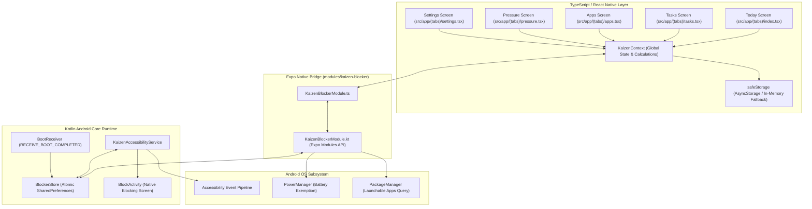
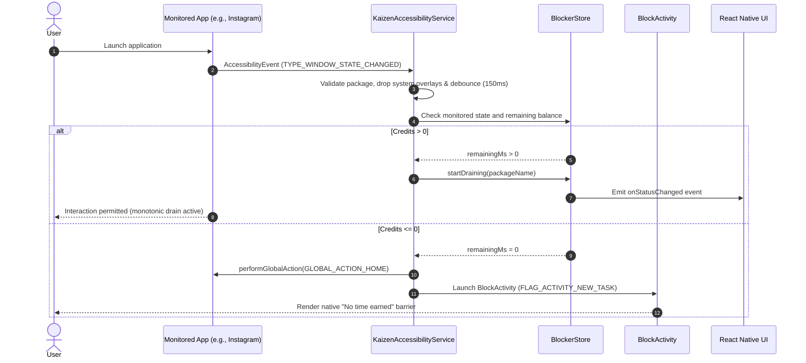
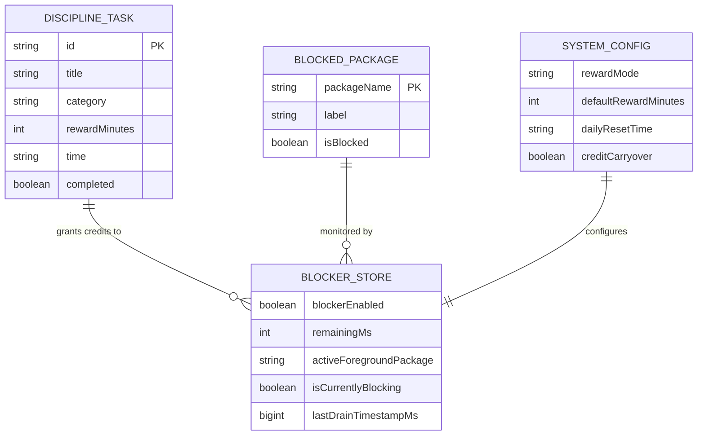
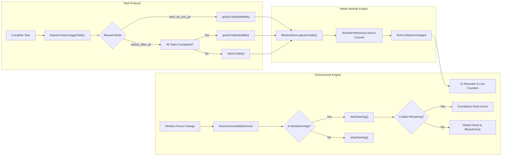

# KAIZEN (改善)
**Earn your escape.**


KAIZEN is an offline-first, native Android screen-time enforcement platform built using Expo SDK 58 and a custom Kotlin native module. It re-engineers digital habits by treating recreational screen time as an earned commodity, requiring users to complete real-world discipline protocols before distracting applications are unlocked. By pairing atomic monotonic countdown timers with low-level Android accessibility window interception, KAIZEN eliminates bypass loopholes while keeping user data strictly on-device.

---

## Visual Diagrams

### 1. System Architecture



### 2. Data Flow & Enforcement Lifecycle



### 3. Local Entity Relationship Diagram



### 4. Component Interaction & Credit Lifecycle



---

## Problem Statement

Modern mobile applications are purposefully engineered to capture cognitive bandwidth through variable-ratio reward schedules and frictionless infinite loops. Standard platform-level tools, such as basic operating system timers, suffer from structural vulnerabilities:

- **Frictionless Bypasses**: Native timers present simple "Ignore limit for 15 minutes" overrides, making discipline optional at the precise moment self-control is weakest.
- **Detached Incentives**: Conventional screen-time utilities track consumption retrospectively rather than conditioning access on positive productivity behaviors.
- **Privacy Violations**: Commercial third-party blocker applications frequently route mobile traffic through remote VPNs or cloud servers, exfiltrating personal app telemetry and charging recurring subscription fees.
- **Fragile Background Execution**: Ineffective background services are routinely terminated by aggressive vendor battery optimizations (such as Samsung One UI or Xiaomi MIUI), leaving devices unprotected.

Without an uncompromised, local-first enforcement boundary, users remain trapped in involuntary consumption patterns.

---

## Solution Overview

KAIZEN transforms the relationship between effort and digital consumption by establishing an earned-credit economy governed by low-level operating system drivers:

- **Earned-Access Paradigm**: Monitored applications remain inaccessible by default until users complete positive real-world disciplines (Focus, Vitality, Learning, Mindfulness, Recovery).
- **Native OS Interception**: An autonomous Kotlin accessibility service monitors foreground window transitions, ignoring transient system overlays while immediately restricting unauthorized apps.
- **Monotonic Hardware Clock**: Credit deductions rely strictly on `SystemClock.elapsedRealtime()`, preventing users from resetting device calendar or wall-clock settings to exploit extra time.
- **The Pressure Valve**: Disarming the blocker requires a deliberate 5-second continuous press under the Pressure tab or native screen, introducing cognitive friction while preventing accidental permanent lockouts.
- **Zero-Cloud Architecture**: KAIZEN operates with zero network permissions in release builds. All data, task histories, and enforcement rules reside entirely in secure on-device storage.

---

## Key Features

- **Protocol-Driven Credit Economy**: Complete disciplines to accumulate screen time in two distinct modes: *Earn As You Go* (instant credits per task) or *Unlock After All* (all daily tasks must pass before apps unlock).
- **Zero-Content Accessibility Monitoring**: Intercepts foreground application window changes via Android Accessibility Service with `canRetrieveWindowContent="false"`. No screen text, keystrokes, or media are ever accessed.
- **Monotonic Shared Balance**: Multiple distracting applications drain a single unified credit ledger. Switching between Instagram, Reddit, and YouTube does not restart or grant separate allowances.
- **Failsafe Native Block Screen**: Independent `BlockActivity` presents time remaining, navigation back to home, direct shortcuts back to KAIZEN, and a 5-second long-press emergency disarm trigger.
- **Exempted System Infrastructure**: The default device launcher, dialer, emergency dialers, system UI, and Android Settings are automatically resolved and whitelisted to avoid lockout risks.
- **Boot and Process Persistence**: Automatically re-establishes enforcement on system reboot via `BootReceiver` and maintains credit states across process lifecycle death.
- **Adaptive App Discovery**: Uses launcher intent resolution to enumerate user-facing applications without requesting sensitive broad permissions like `QUERY_ALL_PACKAGES`.
- **Japanese-Inspired Aesthetic**: Minimal dark interface styled with Japanese character motifs (`改善`), deep black backgrounds, and vermilion status accents designed to eliminate visual overstimulation.

---

## Tech Stack

| Category | Technology | Purpose |
| :--- | :--- | :--- |
| **Framework & Runtime** | React Native 0.88.0 & Expo SDK 58 | Mobile application core framework with modern New Architecture compatibility |
| **Language** | TypeScript 6.0.3 & Kotlin | Strict-typed UI state orchestration and memory-safe native Android drivers |
| **Navigation & Routing** | Expo Router 58.0.26 | File-based typed mobile routing (`src/app/(tabs)`) |
| **Native Module Bridge** | Expo Modules API | High-performance, autolinked JNI interface connecting TypeScript to Kotlin |
| **System Enforcement** | Android AccessibilityService | Foreground window state detection and execution of `GLOBAL_ACTION_HOME` |
| **Local Persistence** | Android SharedPreferences | Low-overhead, atomic native key-value storage for credit balances and blocklists |
| **UI Storage** | AsyncStorage with Safe Fallback | Asynchronous client-side state caching for task checklists and user preferences |
| **Animations & Gesture** | React Native Reanimated 4.7.1 | Fluid UI transitions and 60 FPS hold-to-disarm interaction handling |
| **Styling & Tokens** | Custom Theme Engine | Centralized design tokens conforming to WCAG AA contrast standards |

---

## Quick Start/Installation

### Prerequisites

Ensure the following tools are installed on your workstation:

- **Node.js**: v18.0.0 or higher
- **Package Manager**: `npm` or `bun`
- **JDK**: Java Development Kit 17
- **Android SDK**: Android Studio with Android SDK Platform 34+ and Command-line Tools
- **Physical Android Device**: Connected via USB with Developer Options and USB Debugging enabled

### 1. Clone and Install Dependencies

```bash
git clone https://github.com/TanmayAggarwal87/kaizen.git
cd kaizen
npm install
```

### 2. Scaffold Native Android Project

Because KAIZEN relies on custom native Kotlin drivers inside `modules/kaizen-blocker`, Expo Go cannot be used. Generate the native Android scaffold using Continuous Native Generation:

```bash
npx expo prebuild --platform android
```

### 3. Build and Run on Connected Android Device

Verify that your device is recognized by ADB, then compile and launch the development build:

```bash
# Verify connected device
adb devices

# Compile and install onto the device
npx expo run:android
```

### 4. Enable Required Android Permissions

Upon launching KAIZEN on a physical phone:

1. **Accessibility Service**: Navigate to `Settings` -> `Accessibility` -> `Installed Services` (or `Downloaded Apps`) -> Select **KAIZEN** -> Toggle **ON**.
2. **Restricted Settings (Android 13+)**: If the accessibility toggle is disabled or grayed out, open `App Info` for KAIZEN -> tap the top-right three dots menu -> select **Allow restricted settings**, then authenticate and return to the Accessibility menu.
3. **Battery Optimization**: Open KAIZEN's Settings tab -> tap **Unrestricted Battery** -> confirm the exemption dialog to prevent background service termination.

---

## Environment Variables

KAIZEN is engineered as a local-first system. It requires no third-party cloud API keys, analytics tokens, or remote database credentials. The environment flags below control local development and compilation behavior:

| Variable | Description | Example | Required |
| :--- | :--- | :--- | :--- |
| `EXPO_PUBLIC_APP_ENV` | Application runtime environment target (`development`, `staging`, `production`) | `development` | No |
| `EXPO_DEBUG` | Enables verbose logging output from the Expo CLI bundler | `true` | No |
| `CI` | Disables interactive prompts during automated build workflows | `false` | No |

### Example `.env` Configuration

```bash
# Environment target
EXPO_PUBLIC_APP_ENV=development

# Build diagnostics
EXPO_DEBUG=false
CI=false
```

---

## API Endpoints (Native Module Bridge Interface)

Because KAIZEN is strictly offline and local-first by architectural design, it does not host or consume external HTTP REST/GraphQL endpoints. Instead, communication occurs across the native JNI bridge exposed by `modules/kaizen-blocker`.

### Native Bridge Method Reference

| Method | Signature | Description | Layer |
| :--- | :--- | :--- | :--- |
| `getStatus()` | `() => BlockerStatus` | Returns a snapshot of running state, battery exemption, active app, and remaining time | JNI / Kotlin |
| `setBlockerEnabled(enabled)` | `(enabled: boolean) => void` | Globally engages or suspends the enforcement engine | JNI / Kotlin |
| `setBlockedApps(packages)` | `(packages: string[]) => void` | Updates and persists the list of target package identifiers to monitor | JNI / Kotlin |
| `grantCredits(ms)` | `(ms: number) => void` | Adjusts the monotonic credit balance up or down (clamped to 24 hours maximum) | JNI / Kotlin |
| `clearCredits()` | `() => void` | Atomically drains the shared credit balance to zero | JNI / Kotlin |
| `getInstalledApps()` | `() => AppInfo[]` | Queries Android `PackageManager` for launchable launcher activities | JNI / Kotlin |
| `openAccessibilitySettings()` | `() => void` | Dispatches native Android Intent opening the system accessibility configuration | JNI / Kotlin |
| `requestIgnoreBatteryOptimizations()` | `() => void` | Triggers the system prompt to whitelist KAIZEN from battery killing | JNI / Kotlin |

### Bridge Invocation Example (TypeScript)

```typescript
import { getStatus, grantCredits, setBlockedApps } from 'kaizen-blocker';

// Read atomic system state
const status = getStatus();
console.log('Blocker active:', status.blockerEnabled);
console.log('Remaining milliseconds:', status.remainingMs);

// Grant 15 minutes of earned screen time (in milliseconds)
grantCredits(15 * 60 * 1000);

// Update targeted applications
setBlockedApps([
  'com.instagram.android',
  'com.twitter.android',
  'com.google.android.youtube',
]);
```

### Local Dev Diagnostics Endpoint

During local development, the Metro bundler exposes a local diagnostic endpoint for testing harness connectivity:

```bash
# Query Metro bundler server status
curl -s http://localhost:8081/status
```

Expected response:

```json
{
  "status": "packager-status:running"
}
```

---

## Project Structure

```
kaizen/
├── .agents/                               # Antigravity CLI and agent workflow definitions
├── android/                               # Generated native Android project (Continuous Native Generation)
├── assets/                                # Application icons, splash screens, and static imagery
├── modules/
│   └── kaizen-blocker/                    # Local Expo Native Module (Kotlin enforcement core)
│       ├── android/
│       │   ├── build.gradle               # Gradle build script for native module
│       │   └── src/main/
│       │       ├── AndroidManifest.xml    # Native declarations (Services, Receivers, Activities)
│       │       ├── java/expo/modules/kaizenblocker/
│       │       │   ├── BlockActivity.kt   # Native full-screen barrier activity
│       │       │   ├── BlockerStore.kt    # Thread-safe SharedPreferences & monotonic timer
│       │       │   ├── BootReceiver.kt    # Restores blocking state upon device boot
│       │       │   ├── KaizenAccessibilityService.kt # Window state listener & home action trigger
│       │       │   └── KaizenBlockerModule.kt        # JNI Module definition for Expo Bridge
│       │       └── res/
│       │           ├── values/strings.xml
│       │           └── xml/accessibility_service_config.xml # Least-privilege accessibility config
│       ├── expo-module.config.json        # Autolinking configuration for Expo Modules
│       ├── index.ts                       # Module public API entry point
│       └── src/
│           ├── KaizenBlocker.types.ts     # TypeScript interface definitions
│           ├── KaizenBlockerModule.ts     # Native module bridge binding
│           └── KaizenBlockerModule.web.ts  # Web fallback mock implementation
├── src/
│   ├── app/                               # Expo Router file-based screens
│   │   ├── (tabs)/
│   │   │   ├── _layout.tsx                # Bottom tab bar configuration
│   │   │   ├── apps.tsx                   # Monitored app picker and filter list
│   │   │   ├── index.tsx                  # "Today" dashboard and metrics overview
│   │   │   ├── pressure.tsx               # "The Pressure Valve" disarm hold screen
│   │   │   ├── settings.tsx               # Enforcement settings and permission status
│   │   │   └── tasks.tsx                  # Discipline task manager and credit rewards
│   │   └── _layout.tsx                    # Root stack layout and context provider mount
│   ├── constants/
│   │   └── theme.ts                       # KAIZEN dark + vermilion design tokens
│   ├── context/
│   │   └── KaizenContext.tsx              # Reactive state orchestration & metrics engine
│   └── utils/
│       └── storage.ts                     # Storage wrapper with in-memory resilient fallback
├── app.json                               # Expo project manifest and build configuration
├── DECISIONS.md                           # Formal architectural decision records (ADRs)
├── package.json                           # Node.js project dependencies and scripts
├── PROGRESS.md                            # Development milestone tracking log
├── todo.md                                # Product roadmap and verification checklist
└── tsconfig.json                          # Strict TypeScript compiler options
```

---

## Deployment & Architecture Decisions

### Native Android vs. Cross-Platform Compromises

| Approach | Verdict | Technical Reasoning |
| :--- | :--- | :--- |
| **AccessibilityService (Chosen)** | **Adopted** | Grants exact, zero-latency detection of `TYPE_WINDOW_STATE_CHANGED` events without polling, screen content inspection, or VPN battery penalties. |
| **UsageStatsManager Polling** | **Rejected** | Requires continuous background polling intervals (1-2 seconds), introduces noticeable block delay, and suffers heavy battery penalties from wake locks. |
| **Local VPN Interception** | **Rejected** | Disrupts existing VPN connections, cannot distinguish between browser web browsing and native applications, and demands excessive system privileges. |
| **Third-Party Blocker SDKs** | **Rejected** | Introduce closed-source binary blobs, risk privacy violations, and complicate security audits. All Kotlin code is owned directly in `modules/kaizen-blocker`. |

### Local-First Architecture

KAIZEN requires no account registration, remote database synchronization, or network connectivity. This architectural choice delivers:

1. **Zero Attack Surface**: No sensitive user app usage logs or discipline records ever leave the mobile device.
2. **Absolute Reliability**: Enforcement continues without interruption when the device is offline, in Airplane mode, or in low-connectivity areas.
3. **Zero Operating Overhead**: Eliminates server maintenance, hosting infrastructure costs, and third-party SaaS dependencies.

### Monotonic Clocks vs. Wall-Clock Timers

Operating systems allow users to adjust calendar dates and wall-clock times manually via system settings. Utilizing standard timestamps (`System.currentTimeMillis()`) would allow users to exploit infinite screen time simply by setting the device clock backward. 

KAIZEN addresses this vulnerability by coupling all credit deductions to `SystemClock.elapsedRealtime()`. This hardware timer ticks monotonically since system boot and is completely impervious to manual time zone or calendar changes.

---

## Technical Challenges & Solutions

### 1. Android 13+ Restricted Settings on Sideloaded Apps

- **The Challenge**: Beginning in Android 13, Google blocks users from activating Accessibility Services for applications installed outside official app stores, marking the toggle as "Restricted setting".
- **The Solution**: Implemented proactive detection inside `settings.tsx` and `KaizenBlockerModule.kt`. When an inactive accessibility service is detected on Android 13+, KAIZEN displays clear visual onboarding directing the user to navigate to `App Info` -> tap the contextual overflow menu -> select `Allow restricted settings`, allowing seamless activation on sideloaded development builds.

### 2. Transient Window Overlay Flapping

- **The Challenge**: System dialogs, volume sliders, permission controllers, and soft keyboards (such as Gboard or Samsung Keyboard) fire `TYPE_WINDOW_STATE_CHANGED` events. In naive implementations, opening a keyboard inside a monitored app causes the package name to change, pausing the countdown or triggering rapid start/stop drain loops.
- **The Solution**: Engineered an intelligent package filter inside `KaizenAccessibilityService.kt`:
  - Maintained an explicit ignore list for system overlays (`com.android.systemui`, `com.google.android.gms`, OEM notification shades).
  - Whitelisted keyboard input methods using package heuristics (`.ime`, `inputmethod`, `keyboard`).
  - Added a 150ms debounce threshold on window state events to eliminate spurious flapping.

### 3. Aggressive OEM Battery Killers & Deep Sleep

- **The Challenge**: OEM task managers (specifically Samsung One UI Sleeping Apps and Xiaomi battery savers) aggressively freeze background processes and revoke accessibility hooks if an app remains in the background overnight.
- **The Solution**: 
  - Integrated `requestIgnoreBatteryOptimizations()` via the native bridge to request exemption from system Doze mode.
  - Implemented `BootReceiver` listening for `ACTION_BOOT_COMPLETED` to immediately verify and re-initialize `BlockerStore` on startup.
  - Added prominent UI health checks in the Today screen that immediately warn the user if background execution has been interrupted.

---

## Development Commands

| Command | Purpose |
| :--- | :--- |
| `npx expo start` | Starts the Metro development server for code bundling |
| `npx expo run:android` | Builds the native Android application and deploys it to a connected device/emulator |
| `npx expo lint` | Executes ESLint to verify code quality and style conventions |
| `npx tsc --noEmit` | Runs strict static type-checking across all TypeScript files |
| `npx expo-doctor` | Diagnoses project health, configuration validity, and SDK package compatibility |
| `npx expo prebuild --clean` | Regenerates the `android/` directory from `app.json` and local module manifests |
| `adb logcat -s KaizenBlocker` | Streams real-time diagnostic output from the native Kotlin module |

---

## Testing Approach

### Current State: Physical Device Verification

KAIZEN's core blocking engine relies on low-level operating system hooks that cannot be faithfully simulated in standard emulators. Verification is conducted on real Android hardware across the following criteria:

| Test Case | Scenario | Expected Outcome | Status |
| :--- | :--- | :--- | :--- |
| **Zero Credit Enforcement** | Open blocked app with 0 ms balance | Immediately dismissed to Home; `BlockActivity` displays | Verified |
| **Credit Draining** | Open blocked app with active credits | Allowed foreground access; credits drain at 1x speed | Verified |
| **Multi-App Switching** | Switch between Instagram and YouTube | Single shared credit pool drains continuously without reset | Verified |
| **Pause on Exit** | Navigate from blocked app to Home screen | Draining ceases immediately; balance preserves | Verified |
| **Clock Tampering** | Set system time back 24 hours | Monotonic clock prevents time manipulation | Verified |
| **Emergency Disarm** | Hold Pressure button for 5 seconds | Enforcement suspends; countdown displays visually | Verified |
| **Reboot Survival** | Restart phone with credits remaining | State restored upon boot via `BootReceiver` | Verified |

### Planned Automated Testing

- **Unit Testing**: Jest test suites targeting `KaizenContext` state transitions, credit computation functions, and task completion reducers.
- **Native Driver Testing**: Robolectric tests for `BlockerStore` atomic commits and package sanitization regular expressions.
- **End-to-End Testing**: Automated Maestro flows verifying tab navigation and settings screen workflows.

---

## Contributing Guidelines

Contributions to KAIZEN are welcomed with open arms. Whether you are refining native Kotlin performance, polishing Japanese typography, or improving accessibility handling, your input helps build a more intentional computing environment.

1. **Fork the Repository**: Create a dedicated feature branch (`git checkout -b feature/intentional-focus`).
2. **Adhere to Code Quality**: Ensure `npx tsc --noEmit` and `npx expo lint` pass with zero errors before submitting.
3. **Preserve Native Integrity**: Any changes to `modules/kaizen-blocker` must respect the least-privilege principle: never inspect window content, never request network access, and avoid adding third-party native dependencies.
4. **Submit a Pull Request**: Provide a concise summary of changes, motivation, and device test results in your PR description.

---

## Links

- **Repository**: [https://github.com/TanmayAggarwal87/kaizen](https://github.com/TanmayAggarwal87/kaizen)
- **Expo Documentation**: [https://docs.expo.dev](https://docs.expo.dev)
- **Android Accessibility Guides**: [https://developer.android.com/guide/topics/ui/accessibility](https://developer.android.com/guide/topics/ui/accessibility)
- **Issue Tracker**: [https://github.com/TanmayAggarwal87/kaizen/issues](https://github.com/TanmayAggarwal87/kaizen/issues)

---

## License

This project is licensed under the terms of the **MIT License**. You are free to inspect, modify, and distribute the codebase in accordance with the license conditions. See the [LICENSE](LICENSE) file for complete details.

---

## Author Section

Built by [Tanmay Aggarwal](https://github.com/TanmayAggarwal87)  
Email: tanmayagg.2005@gmail.com

--made by [docify](https://docify-two.vercel.app/) --
